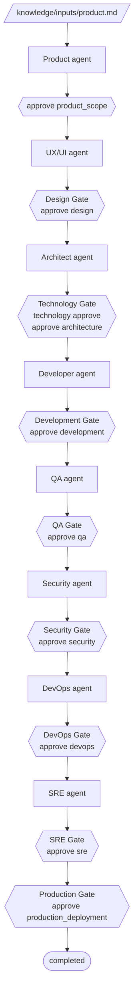

# ai-software-factory

A command-line tool that takes a software project from a product idea to a
production-approved codebase by running a fixed sequence of specialised AI
agents, with a human approval gate after each one.

Each agent (product, UX/UI, architecture, development, QA, security, DevOps,
SRE) works from the same project context and returns a structured result.
The Factory checks that result, runs the tests and checks the agent declared,
and stops at a gate. Nothing moves to the next phase until a human runs
`ai-factory approve`. The whole workflow state lives in
`.factory/state.yaml` inside the project, so a run can be stopped, inspected,
resumed, retried or restored from a checkpoint at any point.

Two model providers ship with the Factory:

- `mock`: deterministic and offline. It needs no API key and is the default
  for new projects. Use it to try the workflow and in tests.
- `openai`: the OpenAI Responses API with strict JSON-schema structured
  outputs. Any OpenAI-compatible endpoint works through `base_url`.

## Workflow



`ai-factory run-workflow` runs ready agents until the next gate, then stops
and says what it is waiting for. A gate only reaches `READY_FOR_REVIEW` once
the Factory's own checks pass. The human approval comes after that, and the
Factory cannot record it for you.

| Gate | Opens for review when | Approved with |
| --- | --- | --- |
| Product scope | The product agent completed | `approve product_scope` |
| Design | Every configured UX/UI deliverable exists | `approve design` |
| Technology | The architect submitted a technology proposal | `technology approve`, then `approve architecture` |
| Development | Implementation results exist, are not blocked, and their test commands passed | `approve development` |
| QA | Executed test commands passed and no Critical/High defect is unresolved | `approve qa` |
| Security | Executed checks passed and no Critical/High finding is unresolved | `approve security` |
| DevOps | Checks passed, deployment readiness and a rollback strategy are declared | `approve devops` |
| SRE | Checks passed, observability and incident readiness are declared | `approve sre` |
| Production | Every previous phase is approved | `approve production_deployment` |

Agents can propose commands, findings and severities. Whether a phase passed
is derived from what actually ran. A failed or blocked agent can be sent back
with `ai-factory retry <agent>`. A blocker that needs a human decision stops
the workflow until `ai-factory resume <agent>` or
`ai-factory resolve-blocker <approval>`.

Agent contracts live in [`agents/`](agents/). The full design is in
[`docs/architecture/`](docs/architecture/).

## Installation

Requires Python 3.11 or newer.

```bash
git clone https://github.com/wankamdypuedilane/ai-software-factory.git
cd ai-software-factory
python -m venv .venv
source .venv/bin/activate        # Windows: .venv\Scripts\activate
python -m pip install -e ".[dev]"
```

Check the installation:

```bash
ai-factory --version
python -m pytest -q
```

## Example session (mock provider)

This session takes a new project from `init` to `completed` without any API
key. Output is shortened where marked with `...`.

```console
$ ai-factory init "Todo App"
Project created: /work/todo-app
Factory state: /work/todo-app/.factory/state.yaml
Product input: /work/todo-app/knowledge/inputs/product.md
Next: describe your product in that file, then run 'ai-factory run-workflow' from the project directory.

$ cd todo-app
$ ai-factory status
Project: Todo App
Phase: discovery

product      READY
ux_ui        NOT_STARTED
architect    NOT_STARTED
...
Next agent: product

$ ai-factory run-workflow
Agent: product
Status: COMPLETED
...
Workflow stopped.
Agent 'product' is waiting for human review.

$ ai-factory approve product_scope
Human approval recorded: product_scope

$ ai-factory run-workflow
Agent: ux_ui
Status: COMPLETED
...
Artifact requests:
- design/ux-ui/accessibility-requirements.md: Define accessibility requirements.
- design/ux-ui/design-system.md: Define the project design system.
...
Workflow stopped.
UX/UI is waiting for Design Gate completion.
Design Gate status: READY_FOR_REVIEW
Deliverables: 7/7

$ ai-factory approve design
Human approval recorded: design

$ ai-factory run-workflow
Agent: architect
...
Architect is waiting for Technology Gate completion.
Technology Gate status: REVIEW_REQUIRED
Human approval: pending

$ ai-factory technology approve
Technology proposal approved and applied to project configuration.

$ ai-factory approve architecture
Human approval recorded: architecture

$ ai-factory run-workflow
Agent: developer
...
Developer is waiting for Development Gate completion.
Development Gate status: READY_FOR_REVIEW
Human approval: pending

$ ai-factory approve development
Human approval recorded: development
```

QA, Security, DevOps and SRE follow the same pattern: run `run-workflow`,
review, then `approve qa`, `approve security`, `approve devops` and
`approve sre`. The session ends with the Production Gate:

```console
$ ai-factory run-workflow
Workflow stopped.
Production deployment is waiting for Production Gate completion.
Production Gate status: READY_FOR_REVIEW
Human approval: pending

$ ai-factory approve production_deployment
Human approval recorded: production_deployment

$ ai-factory run-workflow
Workflow stopped.
Project workflow is completed.

$ ai-factory status
Project: Todo App
Phase: completed

product      APPROVED
...
sre          APPROVED
...
Workflow Gates:
  Technology Gate     APPROVED            approved
  Development Gate    APPROVED            approved
  QA Gate             APPROVED            approved
  Security Gate       APPROVED            approved
  DevOps Gate         APPROVED            approved
  SRE Gate            APPROVED            approved
  Production Gate     APPROVED            approved

Next agent: none
```

The project directory then contains the UX/UI deliverables under
`design/ux-ui/`, the generated code and tests under `src/` and `tests/`, and
the workflow state under `.factory/`.

Other useful commands:

| Command | Purpose |
| --- | --- |
| `ai-factory next` | Show the next agent that should work |
| `ai-factory run` | Run only the next ready agent |
| `ai-factory retry <agent>` | Re-run a blocked, failed or review-required agent |
| `ai-factory resume <agent>` | Resume a blocked agent once the human input is provided |
| `ai-factory resolve-blocker <approval>` | Record that a gate's external blockers were resolved |
| `ai-factory checkpoint create\|list\|restore` | Capture and restore workflow milestones |
| `ai-factory technology status\|submit\|approve` | Manage the Technology Gate |

## Using OpenAI

Switch the provider in the project's `.factory/project.yaml`:

```yaml
ai:
  provider: openai
  model: <model-id>          # any model that supports the Responses API
                             # with structured outputs

  settings:
    max_output_tokens: null                      # shared default budget
    agent_max_output_tokens: null                # agent runs
    artifact_max_output_tokens: null             # generated documents
    implementation_max_output_tokens: null       # implementation tasks
    implementation_retry_max_output_tokens: null # one retry when truncated
    base_url: null       # OpenAI-compatible endpoint; null = SDK default
    api_key_env: null    # variable holding the key; null = OPENAI_API_KEY
```

Then provide the key, either in the environment or in a `.env` file:

```bash
export OPENAI_API_KEY=sk-...
```

The Factory reads `.env` from the current project directory first, then from
the Factory checkout. Variables already set in the environment take
precedence over both. `.env` is ignored by git.

To use another OpenAI-compatible server, set `base_url` and point
`api_key_env` at the variable that holds its key:

```yaml
  settings:
    base_url: https://llm.internal.example/v1
    api_key_env: INTERNAL_LLM_API_KEY
```

Rate limits, timeouts and rejected requests stop the run with a classified
error and leave the workflow state unchanged, so the same command can simply
be run again.

Set `AI_FACTORY_HOME` to load agent contracts and project templates from a
directory other than the installed package.

## Repository layout

```text
agents/          Agent contracts (AGENT.md per agent)
templates/       Project template copied by `ai-factory init`
src/ai_factory/  CLI, workflow engine, gates, providers
tests/           pytest suite (no network, no API key)
docs/            Architecture and agent protocol
projects/        Empty placeholder for local projects (`init` creates the
                 project in the current directory)
```

## Design decisions & limitations

<!-- TODO(author): write this section. -->

- TODO: Why a fixed, linear agent sequence rather than a dynamic planner.
- TODO: Why every phase ends with a mandatory human approval.
- TODO: What the gates can verify (executed commands) and what stays an agent
  assertion (severities, deployment readiness, rollback strategy).
- TODO: Retry and re-plan budgets, and what happens when they run out.
- TODO: Provider support today (OpenAI and mock) and how to add another.
- TODO: Known limitations and what is out of scope.
